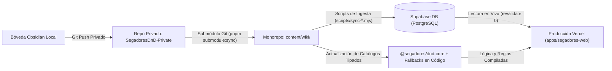

# Reglas y Lineamientos del Proyecto SegadoresDnD

Este documento define las reglas de desarrollo, arquitectura, licencias y compatibilidad que DEBEN seguir todos los modelos de IA y desarrolladores que colaboren en este repositorio.

---

## 1. Licenciamiento Dual y Propiedad Intelectual

1. **Código Fuente del Proyecto (Licencia MIT):**
   * Todo el software original, lógica de TypeScript, componentes React, estilos Tailwind y configuraciones de infraestructura están bajo la licencia **MIT**.
   * Cualquier persona es libre de usar, estudiar y compilar el código fuente.
2. **Contenido de D&D y Mocks (Licencia Creative Commons CC-BY-4.0):**
   * Las reglas de juego, tablas y contenido textual de D&D presentes en `content/mocks/` derivan del **System Reference Document (SRD 5.1 / 5.2.1)** publicado por Wizards of the Coast LLC bajo licencia **CC-BY-4.0**.
   * La licencia CC-BY-4.0 **NO contamina el código fuente** (no es copyleft / no tiene cláusula ShareAlike). El código fuente sigue siendo 100% MIT.
   * **Atribución Obligatoria:** Se debe mantener la nota de atribución oficial a Wizards of the Coast en la documentación pública.

---

## 2. Regla Estricta para Generación de Mocks y Tests

* **Fuente Única Autorizada para Mocks Públicos:** Cualquier mock, dato de prueba o fixture añadido a `content/mocks/` o tests unitarios DEBE generarse **exclusivamente a partir del archivo oficial `SP_SRD_CC_v5.2.1.pdf`** (amparado bajo CC-BY-4.0).
* **Prohibición Terminante:**
  * **NUNCA** incluir datos reales de la campaña privada (`SegadoresDnD-Private`), notas del DM o fichas de los jugadores en carpetas públicas o tests.
  * **NUNCA** incluir material de libros comerciales con derechos exclusivos de Wizards of the Coast que no formen parte del SRD público (*Tasha's Cauldron of Everything*, *Xanathar's Guide to Everything*, *Monsters of the Multiverse*, etc.).
* **Estructura Estándar:** Los mocks deben usar la misma sintaxis compatible con `@segadores/obsidian-engine`: frontmatter YAML (`title`, `type`, `tags`), wikilinks relativos `[[...]]` y callouts temáticos (`[!statblock]`, `[!dnd-grid]`, `[!info]`).

---

## 3. Arquitectura del Monorepo (Inversión de Dependencias)

1. **Paquetes Agnósticos (`packages/*`):**
   * `@segadores/dnd-core`: Lógica matemática y reglas puras en TypeScript.
   * `@segadores/character-sheet`: Componentes UI puros y controlados.
   * `@segadores/obsidian-engine`: Parser agnóstico de Markdown y callouts.
   * **REGLA:** Estos paquetes **NUNCA** deben importar Supabase, cookies, ni variables de entorno. Reciben datos por `props` y notifican eventos vía callbacks.
2. **Aplicación Orquestadora (`apps/segadores-web`):**
   * Es la única autorizada para manejar Next.js App Router, llamadas a base de datos (Supabase), autenticación de Google y control de acceso.

---

## 4. Sincronización del Lore y Flujo Canónico de Datos hacia Producción

### Regla Estricta de Aislamiento de Rutas (Prohibición de Rutas Locales Externas)
* **PROHIBICIÓN OBLIGATORIA:** **Ningún agente, script del repositorio ni componente de la aplicación web debe leer o hacer referencia a rutas locales fuera del repositorio** (tales como `/home/william/Proyectos/Obsidian/...`).
* En entornos de integración continua (CI/CD), contenedores Docker, GitHub Actions y despliegues en la nube (Vercel), esas rutas locales del host **no existen** y provocarán roturas fatales en tiempo de ejecución o compilación.

### Pipeline Canónico de 3 Eslabones

1. **Eslabón 1: Bóveda Local $\rightarrow$ GitHub (`SegadoresDnD-Private`) $\rightarrow$ Submódulo `content/wiki/`:**
   * El Dungeon Master o los jugadores redactan y actualizan notas en su bóveda de Obsidian conectada al repositorio privado `SegadoresDnD-Private`.
   * El monorepo incorpora este repositorio como un submódulo Git en `content/wiki/`, actualizado de forma idempotente mediante `pnpm submodule:sync` (`node scripts/sync-wiki.mjs`).

2. **Eslabón 2: Submódulo `content/wiki/` $\rightarrow$ Scripts de Ingesta (`scripts/sync-*.mjs`) $\rightarrow$ Supabase DB + Fallbacks Tipados:**
   * Los scripts del repositorio (`scripts/sync-characters-push.mjs`, etc.) leen **exclusivamente de `content/wiki/`** dentro del workspace.
   * Parsean y normalizan el contenido Markdown y frontmatter YAML, volcando los datos estructurados hacia las tablas de **Supabase**:
     * `public.characters`: Estadísticas completas, atributos, inventarios, recursos, conjuros conocidos y preparados.
     * `public.campaigns`: Campañas activas (`SEG-001: Segadores de Orcos`).
     * `public.campaign_vault`: Baúl comunal de la compañía (pertenencias comunes).
     * `public.campaign_characters`: Vínculos N:M de aventureros a la campaña.
   * Simultáneamente, se sincronizan los catálogos canónicos tipados en código (`@segadores/dnd-core` y `apps/segadores-web/lib/campaign/characters.ts`) como garantía de fallbacks offline y tests unitarios.

3. **Eslabón 3: Producción en Vercel (`apps/segadores-web`):**
   * En los servidores de producción de Vercel (donde el submódulo privado `content/wiki/` puede no clonarse por ausencia de tokens SSH privados en el builder de Vercel), la web opera de forma completamente desacoplada del sistema de archivos local.
   * `apps/segadores-web` consulta directamente las tablas de **Supabase** (con `export const revalidate = 0` para reflejar mutaciones en tiempo real) y los paquetes del monorepo (`@segadores/dnd-core`, `@segadores/character-sheet`, `content/mocks/`), garantizando 100% de disponibilidad, resiliencia y alta performance.

---

## 5. Mantenimiento de CHANGELOG y PRs

* En cada cambio funcional o corrección, actualizar la sección `[Unreleased]` de `CHANGELOG.md` antes de finalizar.
* Al abrir Pull Requests, completar `.github/pull_request_template.md`.

---

## 6. Especificaciones del Entorno Local

* **Sistema:** Arch Linux (Rolling Release) con KDE Plasma sobre Wayland.
* **Gestor de Paquetes:** `pnpm` (no `npm`), `pacman` y `yay` (nunca `apt`, `dnf` ni `paru`).
* **Terminal:** Editores `vim` o `nvim` (nunca `nano`).

---

## 7. Control de Versiones con Git (Regla Estricta para Agentes)

* **PROHIBICIÓN TOTAL DE `git push`:** Los agentes **NUNCA** deben ejecutar `git push` bajo ninguna circunstancia. El usuario es el **único** autorizado y encargado de realizar pushes a los repositorios remotos.
* **Confirmación Previa Obligatoria para `git commit` y `git add`:** Los agentes pueden preparar cambios con `git add` y proponer mensajes de commit semánticos, pero **SIEMPRE deben solicitar aprobación explícita al usuario ANTES de ejecutar el commit**, detallando claramente los archivos afectados y el mensaje que se va a utilizar.
* **Protección Automática Pre-Commit de Secretos:** El repositorio implementa un hook de pre-commit (`.githooks/pre-commit` ejecutando `scripts/verify-secrets.mjs`) que audita en el stage la presencia de tokens (GitHub, Supabase, JWTs, AWS), archivos `.env*` o credenciales quemadas. **Prohibido el uso de `--no-verify`** para saltarse estas protecciones.
* **Git Flow y Backport Automático (`main` $\rightarrow$ `develop`):**
  * Flujo de trabajo: Ramas `feature/*` / `fix/*` nacen siempre de `develop` $\rightarrow$ PR a `develop` $\rightarrow$ PR de `develop` a `main`. Prohibido hacer commits directos a `main`.
  * **Regla de Merge en GitHub (`develop` $\rightarrow$ `main`):** Al fusionar un PR de `develop` hacia `main`, usar **siempre "Create a merge commit"** (evitar *"Squash and merge"* entre ramas de larga vida como `develop` y `main` para preservar el ancestro común y evitar conflictos o código duplicado).
  * **Backport Automático (`.github/workflows/sync-main-to-develop.yml`):** Cada vez que ingresa un commit a `main`, GitHub Actions ejecuta automáticamente el backport hacia `develop` para mantener ambas ramas alineadas en historial de commits.

---

## 8. Control de Visibilidad de Lore y Anti-Metajuego (Player vs DM)

* **Sintaxis en Markdown:** Todas las notas procesadas por `@segadores/obsidian-engine` pueden incluir:
  * Frontmatter: `visibility: 'player' | 'dm'`.
  * Tags: `#player-facing` o `#dm-only`.
  * Callouts secretos: `> [!dm] Título` para fragmentos confidenciales dentro de notas públicas.
* **Comportamiento Obligatorio del Motor Web:**
  * Si el usuario autenticado tiene rol `player`: omitir completamente archivos con `visibility: dm` o dentro de carpetas restringidas (`Campañas predefinidas/`, `Bestiario/`). Retornar 404 en rutas directas y purgar bloques `> [!dm]` del HTML.
  * Si el usuario autenticado tiene rol `dm`: renderizar contenido íntegro con distintivo visual 🔒 de privacidad y diseño temático especial para callouts `> [!dm]`.

---

## 9. Integridad y Veracidad Estricta de las Pruebas (Prohibición de Tests Placebo y Falsos Positivos)

Para garantizar la confiabilidad real del sistema y evitar que los agentes o desarrolladores den por buenas implementaciones basándose en "pruebas verdes" que no comprueban la realidad, rigen las siguientes reglas obligatorias e inquebrantables:

1. **Prohibición Total de Tests Tautológicos o Placebo:**
   * **NUNCA** escribir tests con aserciones triviales o vacías (ej. `assert.ok(true)`, `assert.ok(result)`, comprobar literales inventados dentro del propio test, o tests que sólo evalúan que una función "no lanzó error" sin revisar qué devolvió).
   * Un test sólo es válido si somete las entradas a la lógica de producción real y comprueba las salidas contra criterios de negocio matemáticos y canónicos explícitos.
2. **Verificación Estricta del Diferencial de Estado (*State Diff & Mutation Testing*):**
   * En cualquier operación que represente una mutación, cálculo o transición de estado (subir de nivel, aplicar daño o curación, gastar o recuperar dados de golpe, descansar, deducir o sumar PX, equipar armas o sintonizar objetos):
     * El test **DEBE capturar y contrastar el estado ANTES y DESPUÉS** de la llamada.
     * El test **DEBE verificar la fórmula matemática exacta del cambio** (ej. `after.experience_points === before.experience_points - cost`, `after.max_hp === before.max_hp + hpGained`, `after.level === before.level + 1`).
     * El test **DEBE comprobar la invariabilidad e inmutabilidad** de las propiedades que no debían ser alteradas por la acción.
3. **Prohibición Terminante de Auto-Mocking Engañoso:**
   * **NUNCA** sustituir con mocks o espías la lógica que se pretende evaluar (ej. mockear la función de cálculo de multiclase o la tirada de dados de golpe para que devuelva un valor arbitrario en vez de ejecutar la implementación real del motor).
   * Los mocks y stubs sólo están autorizados en los límites exteriores de I/O (red, peticiones remotas a Supabase o proveedores de Auth).
   * La lógica matemática (`@segadores/dnd-core`), los componentes de interfaz puros (`@segadores/character-sheet`) y los motores de parsing (`@segadores/obsidian-engine`) **deben probarse siempre con ejecuciones reales sobre contratos canónicos completos**.
4. **Verificación Obligatoria de Casos Negativos y Fronteras (*Boundary Testing*):**
   * Todo módulo de reglas debe contar con tests que fuercen y comprueben el **fallo controlado**:
     * Rechazo si no se cumplen los requisitos (ej. faltan PX, características menores a 13 para multiclase, límite de nivel 20 alcanzado, exceso de las 3 ranuras de sintonización).
     * Comprobar que ante un fallo o validación negativa, el estado del personaje **no sufre mutaciones parciales ni corrupciones**.
5. **Criterio de Rechazo en Auditoría de PRs:**
   * Cualquier prueba que pretenda simular que un flujo funciona sin ejecutar y verificar el impacto real de los cambios será considerada una violación de los lineamientos del repositorio y motivo de rechazo inmediato.

---

## 10. Gobernanza de CI/CD, Despliegues en Vercel y Dependencias en Monorepos (pnpm Workspaces)

Para garantizar despliegues limpios, reproducibles y sin fallos en Vercel, todos los agentes y desarrolladores deben seguir obligatoriamente estas reglas técnicas:

1. **Sincronización Estricta del Lockfile (`--frozen-lockfile` en Vercel):**
   * En los entornos de CI/CD de Vercel, `pnpm install` se ejecuta de forma predeterminada con el flag `--frozen-lockfile`.
   * **REGLA OBLIGATORIA:** Cada vez que se agregue, actualice, cambie de versión o elimine una dependencia (en `dependencies`, `devDependencies` o `peerDependencies`) de **cualquier** `package.json` del monorepo (`apps/*` o `packages/*`), es **mandatorio ejecutar `pnpm install` localmente** para regenerar exhaustivamente `pnpm-lock.yaml`.
   * **PROHIBICIÓN:** Está terminantemente prohibido commitear cambios en archivos `package.json` sin incluir en el mismo commit el archivo `pnpm-lock.yaml` actualizado.

2. **Declaración Explícita de Tipos TypeScript (`@types/*`) por Paquete:**
   * `pnpm` utiliza una estructura de almacenamiento virtual estricta y aislada (`.pnpm/`). Los paquetes en `packages/*` **no heredan** tipos TypeScript implícitamente de la raíz ni de `apps/segadores-web`.
   * **REGLA OBLIGATORIA:** Todo paquete que contenga código JSX/TSX o importe React (`@segadores/character-sheet`, `@segadores/ui`, `@segadores/obsidian-engine`) **debe declarar explícitamente** `@types/react` y `@types/react-dom` en su sección `devDependencies`, manteniendo consistencia con las versiones del workspace.
   * Nunca asumir que una biblioteca compila porque funciona en local; las cachés locales ocultan dependencias faltantes que CI hace fallar con `Type error: Could not find a declaration file for module 'react'`.

3. **Verificación Previa a la Entrega (Checklist de CI Local):**
   * Antes de proponer un commit o considerar concluida una tarea que toque dependencias o componentes, el agente debe verificar localmente:
     1. `pnpm install --frozen-lockfile` $\rightarrow$ Comprueba que el lockfile está al 100% en sincronía con todos los paquetes.
     2. `pnpm run build` (`turbo run build`) $\rightarrow$ Comprueba que el compilador de Next.js transpile paquetes, apruebe la validación de tipos (`tsc`) y genere todas las páginas estáticas y dinámicas.

4. **Resiliencia ante Submódulos Git Privados:**
   * `content/wiki` es un submódulo Git vinculado al repositorio privado de notas. Vercel emitirá `Warning: Failed to fetch one or more git submodules` si no tiene credenciales de lectura para dicho repositorio.
   * La aplicación Next.js y los paquetes del monorepo **deben tolerar siempre la ausencia del submódulo privado**, conmutando limpiamente a los mocks canónicos de `content/mocks/` sin arrojar excepciones ni interrumpir la compilación en producción.

