# Blueprint de Arquitectura y Guía de Ejecución: MVP SegadoresDnD

> **Documento de transferencia para agentes y desarrolladores.**
> Este documento sintetiza las decisiones de arquitectura, separación de flujos de datos y la hoja de ruta técnica para iniciar el desarrollo del portal interactivo para jugadores.

---

## 1. Visión General y Filosofía de Arquitectura

El objetivo central de esta fase es construir un **Portal Interactivo para Jugadores** donde ellos puedan gestionar su hoja de personaje y consultar reglas de referencia en tiempo real, mientras el Dungeon Master (DM) mantiene el control de su contenido en Obsidian y puede inspeccionar la base de datos localmente (ej. vía DataGrip).

### Principios Fundamentales
1. **Separación de Flujos de Datos:**
   * **Flujo Bidireccional (Interactivo / Estado en vivo):** Hojas de personaje (HP, ranuras de conjuro, inventario, notas de sesión).
   * **Flujo Unidireccional (Referencial / Compilado):** Hechizos, clases, razas, equipo y habilidades (vienen de Markdown/JSON; son de solo lectura para los jugadores).
2. **Componentes Agnósticos y Desacoplados ("Cajas Reutilizables"):**
   * Ningún componente de interfaz (`packages/character-sheet`, `packages/ui`) conoce Supabase, Vercel ni el sistema de archivos.
   * Reciben datos por `props` y emiten eventos por callbacks (`onDamage`, `onSlotSpend`, `onSave`).
3. **Dualidad Demo Pública (Mocks SRD) vs Campaña Privada (Lore Real):**
   * La misma base de código sirve tanto para un visitante/reclutador que prueba la aplicación con datos ficticios (SRD 5.1/5.2) como para la mesa real de juego autenticada con Google.

---

## 2. Mapa de Flujo de Datos

```mermaid
flowchart TD
    subgraph Referencial [1. Flujo Unidireccional: Reglas y Compendio]
        MD_VAULT["Obsidian: content/wiki/ (Privado)"]
        MD_MOCKS["Mocks SRD: content/mocks/ (Público)"]
        ENGINE["@segadores/obsidian-engine\n(Parser Markdown -> JSON/AST)"]
        STATIC_PAGES["Páginas Estáticas / CDN Vercel\n(/hechizos, /clases, /equipo)"]
        
        MD_VAULT -->|En builds privados| ENGINE
        MD_MOCKS -->|En builds públicos / fallback| ENGINE
        ENGINE --> STATIC_PAGES
    end

    subgraph EstadoVivo [2. Flujo Bidireccional: Hojas de Personaje]
        UI_SHEET["Portal Web del Jugador\n(@segadores/character-sheet)"]
        DB[(PostgreSQL / Supabase\nTablas: players, characters)]
        SCRIPTS["Scripts CLI en Local\n(pnpm sync:db <-> pnpm sync:obsidian)"]
        DATAGRIP["DataGrip (Inspección DM en local)"]
        OBS_SHEETS["Notas de Personajes en Obsidian\n(content/wiki/Personajes_Jugadores/*.md)"]

        UI_SHEET <-->|Mutaciones en vivo / Realtime| DB
        DATAGRIP <-->|Conexión directa PostgreSQL| DB
        DB <-->|Lectura y escritura estructurada| SCRIPTS
        SCRIPTS <-->|Actualiza Markdown y Frontmatter| OBS_SHEETS
    end
```



---

## 3. ¿Base de Datos o Markdown? (Decisión Técnica)

| Tipo de Contenido | Destino Óptimo | Justificación Técnica |
| :--- | :--- | :--- |
| **Hojas de Personaje** *(Vida, slots, estado)* | **Base de Datos (PostgreSQL)** + Script de Sync a Obsidian | **Altamente dinámico:** Cambia segundo a segundo en combate. Necesita persistencia inmediata, WebSockets en tiempo real y concurrencia. |
| **Hechizos** *(Spells)* | **Markdown $\rightarrow$ JSON compilado** | **Estático de referencia:** No cambian durante una partida. Procesarlos en el build (SSG) permite búsquedas y filtros instantáneos sin consumir cuotas de base de datos. |
| **Clases, Razas y Habilidades** | **Markdown $\rightarrow$ JSON compilado** | **Reglas canónicas:** Se redactan en Obsidian (o vienen de mocks públicos) y se renderizan como guías visuales. |
| **Usuarios y Roles** | **Base de Datos (Auth)** | Gestiona la lista blanca de correos de Google y asignación de personajes por `player_id`. |

---

## 4. Separación Pública (Demo) vs Privada (Campaña)

Para que el proyecto funcione como portafolio y a la vez como herramienta de campaña privada:

* **Modo Público / Demo (`/demo` o fallback no autenticado):**
  * Se alimenta exclusivamente de `content/mocks/` (amparado bajo CC-BY-4.0).
  * Los personajes disponibles son personajes de prueba (ej. *Valeros el Guerrero*, *Kyra la Clériga*).
  * Las mutaciones se guardan en el `localStorage` del navegador o en una sesión volátil, permitiendo a cualquier reclutador interactuar sin ensuciar la base de datos real.
* **Modo Privado (`/app` o `/portal`):**
  * Protegido por Next.js Middleware y Google OAuth (`ALLOWED_EMAILS`).
  * Conectado a la base de datos Supabase de producción.
  * Los jugadores solo ven y editan su personaje asignado; el DM tiene selector para ver y supervisar a todo el grupo en combate.

---

## 5. Diseño y Arquitectura de la Landing Page Principal (`/`)

La ruta raíz (`/`) funcionará como **punto de bifurcación temático** y carta de presentación:

### 5.1. Hero Section y Acciones Principales
* **Título Temático:** *SegadoresDnD - Portal de Campaña & Portafolio Técnico*.
* **Bifurcación de Acceso (Call to Actions):**
  1. 🛡️ **"Ingresar como Miembro de la Compañía" (Botón Principal):** 
     * Inicia sesión con Google. Si el correo está en la lista blanca (`ALLOWED_EMAILS`), redirige al portal privado (`/portal` o `/personajes/[id]`).
  2. 🎲 **"Explorar Demo Pública" (Botón Secundario):** 
     * Redirige a `/demo`, permitiendo interactuar con hojas de personaje de prueba y el catálogo de hechizos SRD sin requerir autenticación.
  3. 📜 **"Acerca del Proyecto" / "¿Qué es SegadoresDnD?" (Enlace / Sección Informativa):**
     * **Enfoque en el Software:** Presentación de la plataforma como un proyecto de **software libre** diseñado para que comunidades y mesas de rol dispongan de un portal web en español, moderno y personalizable para sus campañas de D&D.
     * **Origen del Nombre:** Se explica con transparencia que la iniciativa nació originalmente como una solución a medida para la mesa personal de **William Tovar** (la campaña *Segadores de Orcos*), evolucionando hacia una arquitectura modular abierta a otros directores de juego y desarrolladores.
     * **Enlaces:** Repositorio en GitHub ([SegadoresDnD](https://github.com/williamatr/SegadoresDnD)) y perfil profesional / portafolio de William.

### 5.2. Pie de Página (Footer) y Cumplimiento Legal
* **Autoría:** Desarrollado por **William Tovar**. Enlace a GitHub personal y perfil profesional.
* **Licencia de Código:** Software de código abierto distribuido bajo [Licencia MIT](./LICENSE).
* **Atribución de Derechos (WotC):**
  > *"Este proyecto utiliza reglas y material de juego derivados del System Reference Document (SRD 5.1 / 5.2.1) de Wizards of the Coast LLC, disponible bajo licencia Creative Commons Attribution 4.0 International (CC-BY-4.0). El acceso a contenido de campaña extendido es de uso exclusivamente privado y sin fines comerciales."*

---

## 6. Esquema de Base de Datos para PostgreSQL (Compatible con DataGrip y Supabase)

```sql
-- 1. Tabla de Jugadores (Vinculada a Auth)
CREATE TABLE IF NOT EXISTS public.players (
  id UUID PRIMARY KEY DEFAULT gen_random_uuid(),
  auth_user_id UUID UNIQUE, -- auth.users.id de Supabase
  email VARCHAR(255) NOT NULL UNIQUE,
  display_name VARCHAR(100) NOT NULL,
  role VARCHAR(20) NOT NULL DEFAULT 'player' CHECK (role IN ('dm', 'player')),
  created_at TIMESTAMPTZ DEFAULT NOW(),
  updated_at TIMESTAMPTZ DEFAULT NOW()
);

-- 2. Tabla de Hojas de Personaje
CREATE TABLE IF NOT EXISTS public.characters (
  id UUID PRIMARY KEY DEFAULT gen_random_uuid(),
  player_id UUID REFERENCES public.players(id) ON DELETE SET NULL,
  name VARCHAR(100) NOT NULL,
  character_class VARCHAR(50) NOT NULL,
  level INT NOT NULL DEFAULT 1,
  race VARCHAR(50) NOT NULL,
  
  -- Puntos de Golpe
  max_hp INT NOT NULL DEFAULT 10,
  current_hp INT NOT NULL DEFAULT 10,
  temp_hp INT NOT NULL DEFAULT 0,
  hit_dice_total INT NOT NULL DEFAULT 1,
  hit_dice_current INT NOT NULL DEFAULT 1,
  
  -- Clase de Armadura e Iniciativa
  armor_class INT NOT NULL DEFAULT 10,
  speed INT NOT NULL DEFAULT 30,
  proficiency_bonus INT NOT NULL DEFAULT 2,

  -- Atributos y Modificadores (JSONB estructurado)
  -- Formato: {"str": 16, "dex": 14, "con": 15, "int": 10, "wis": 12, "cha": 8}
  ability_scores JSONB NOT NULL DEFAULT '{}'::jsonb,

  -- Ranuras de Conjuro
  -- Formato: {"1": {"total": 4, "used": 1}, "2": {"total": 2, "used": 0}}
  spell_slots JSONB NOT NULL DEFAULT '{}'::jsonb,

  -- Inventario y Monedas
  -- Formato: {"cp": 0, "sp": 10, "gp": 50, "items": [{"id": "1", "name": "Espada Larga", "qty": 1}]}
  inventory JSONB NOT NULL DEFAULT '{}'::jsonb,

  -- Conjuros Preparados / Conocidos
  prepared_spells TEXT[] DEFAULT ARRAY[]::TEXT[],

  -- Notas de sesión del jugador
  player_notes TEXT DEFAULT '',
  
  updated_at TIMESTAMPTZ DEFAULT NOW()
);
```

---

## 7. Hoja de Ruta de Implementación para el Próximo Agente

### Paso 1: Configurar la App Web Base (`apps/segadores-web`)
* Crear punto de entrada de Next.js App Router:
  * `apps/segadores-web/app/layout.tsx`
  * `apps/segadores-web/app/page.tsx`
  * `apps/segadores-web/tsconfig.json`
  * `apps/segadores-web/next.config.mjs`
* Configurar Tailwind CSS y soporte de componentes en el workspace.

### Paso 2: Contratos de Datos y Lógica Matemática (`packages/dnd-core`)
* Definir tipos e interfaces estrictas:
  * `Character`, `AbilityScores`, `SpellSlotPool`, `Spell`, `Item`.
* Implementar funciones puras:
  * Cálculo de modificadores de característica: `Math.floor((score - 10) / 2)`.
  * Cálculo de bono de competencia según nivel: `Math.ceil(1 + level / 4)`.
  * Cálculo de clase de armadura base y modificada.

### Paso 3: Componentes Desacoplados de la Hoja (`packages/character-sheet`)
* Construir componentes puros controlados por props:
  * `<HitPointsCard current={hp} max={maxHp} temp={tempHp} onDamage={fn} onHeal={fn} />`
  * `<SpellSlotsGrid slots={spellSlots} onToggleSlot={fn} />`
  * `<PreparedSpellsList spells={spells} onCast={fn} onTogglePrepare={fn} />`
  * `<AbilityScoresRow scores={scores} />`

### Paso 4: Motor de Lectura de Compendio (`packages/obsidian-engine`)
* Implementar extractor de hechizos desde `content/wiki/` (o `content/mocks/` en fallback):
  * Parsear frontmatter (`level`, `school`, `casting_time`, `range`, `components`).
  * Generar catálogo estructurado para búsqueda instantánea en cliente.

### Paso 5: Persistencia y Scripts de Sincronización
* Integrar cliente de Supabase en `apps/segadores-web/lib/supabase/`.
* Crear script bidireccional en `scripts/sync-characters.mjs`:
  * **Comando `pnpm sync:pull`:** Descarga el estado actual de los personajes en la BD y actualiza el frontmatter y notas en `content/wiki/Personajes_Jugadores/*.md`.
  * **Comando `pnpm sync:push`:** Lee las fichas iniciales de Obsidian y hace un upsert inicial a PostgreSQL.
