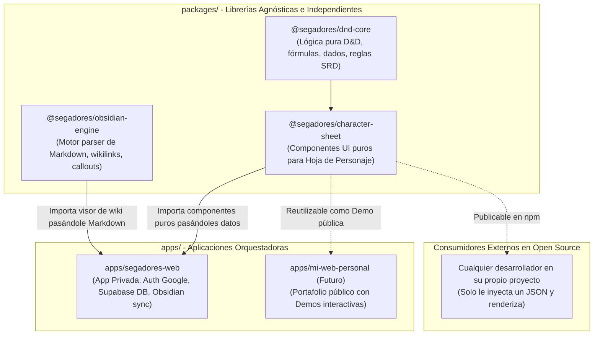

# SegadoresDnD - Especificación Técnica del Proyecto

> Documento de arquitectura, decisiones técnicas y lineamientos de diseño para el desarrollo del sitio web privado de campaña de D&D y portafolio técnico. Diseñado para ser consultado tanto por desarrolladores humanos como por modelos de IA que colaboren en el proyecto.

---

## 1. Visión General del Proyecto

**SegadoresDnD** es una plataforma web privada diseñada para una mesa de juego de Dungeons & Dragons (D&D). El sitio combina dos funcionalidades principales:
1. **Wiki de Campaña / Lore:** Alimentada directamente desde notas en Markdown redactadas por el Dungeon Master (DM) en su bóveda de Obsidian.
2. **Gestor Interactivo de Hojas de Personaje:** Un espacio web donde los jugadores pueden consultar y editar los datos de sus personajes en tiempo real (puntos de golpe, inventario, conjuros, etc.).

### Objetivos Clave
* **Privacidad y Derechos de Autor:** Maneja material de campañas y libros oficiales de D&D. No es un proyecto comercial. El acceso está restringido a una lista blanca de jugadores autorizados y el sitio está completamente oculto a motores de búsqueda (`noindex`, `robots.txt`).
* **Sincronización Ágil:** El DM actualiza el lore desde Obsidian (PC o móvil) sincronizado mediante Git. Los jugadores editan sus hojas en la web sin generar conflictos de Git.
* **Portafolio Profesional:** La arquitectura sirve como base para demostrar habilidades full-stack modernas (Next.js, TypeScript, PostgreSQL/Supabase, CI/CD con Vercel).
* **Dominio Personalizado:** Gestionado a través de Namecheap y conectado a Vercel con SSL automático.

---

## 2. Stack Tecnológico

| Capa / Servicio | Tecnología Seleccionada | Justificación Técnica |
| :--- | :--- | :--- |
| **Arquitectura de Código** | **Monorepo (Turborepo / Workspaces)** | Permite desarrollar librerías y componentes desacoplados (`packages/*`) junto a la aplicación orquestadora (`apps/*`) con despliegue unificado en Vercel. |
| **Framework Full-Stack** | **Next.js (App Router, React 19 / 18)** | Orquestador de la aplicación web: renderizado híbrido (SSG para Markdown, SSR/Client para datos en vivo), Server Actions y API Routes. |
| **Lenguaje** | **TypeScript** | Contratos de interfaces estrictos (`Data Contracts`) que definen cómo los componentes agnósticos reciben datos. |
| **Base de Datos & Auth** | **Supabase (PostgreSQL + Auth + Realtime)** | Base de datos relacional con `jsonb`, autenticación con Google y WebSockets en tiempo real. |
| **Estilos & UI** | **Tailwind CSS + Radix/shadcn** | Componentes estilizados, accesibles y temáticos (fantasía/pergamino/moderno). |
| **Hosting & CI/CD** | **Vercel (Hobby Tier)** | Despliegue continuo con soporte nativo de Turborepo y Next.js. |
| **Gestión de Dominio** | **Namecheap (DNS)** | Solo registro de dominio; CNAME/A configurados hacia Vercel. |
| **Gestión de Contenido** | **Obsidian (Markdown / Wikilinks)** | Fuente de verdad para notas de lore y sesiones. |

---

## 3. Arquitectura del Sistema: Patrón Orquestador & Módulos Agnósticos

El sistema sigue el principio de **Inversión de Dependencias** y separación entre **Componentes de Presentación Puros** y la **Aplicación Orquestadora**:



### 3.1. Filosofía de Componentes Agnósticos (Data Contracts)
Cada paquete dentro de `packages/` es **100% independiente de la infraestructura**:
* **Cero acoplamiento a la base de datos:** `character-sheet` no sabe qué es Supabase, Firebase ni Vercel. Solo recibe un objeto con datos (`props.data`) y emite eventos (`props.onSave`, `props.onDiceRoll`).
* **Cero acoplamiento al sistema de archivos:** `obsidian-engine` no lee discos duros directamente; recibe strings de Markdown y devuelve componentes o árboles AST procesados.
* **Cualquier consumidor puede reutilizarlos:** Tanto tu app privada como un tercero en internet pueden instanciar `<CharacterSheet data={miObjetoJson} />` y el componente funcionará inmediatamente.

### 3.2. Estructura del Repositorio (Monorepo)
```text
SegadoresDnD/
├── apps/
│   ├── segadores-web/           # Aplicación Next.js privada principal (Next.js App Router)
│   │   ├── app/                 # Rutas (/wiki, /personajes, /login)
│   │   ├── lib/                 # Clientes de Supabase, Auth, lectores de Obsidian
│   │   └── middleware.ts        # Protección de rutas con lista blanca de correos
│   │
│   └── web-personal/            # (Futuro) Portafolio público consumiendo los mismos paquetes
│
├── packages/
│   ├── dnd-core/                # TypeScript puro: fórmulas, modificadores, tiradas de dados
│   ├── character-sheet/         # React + Tailwind: componentes UI de hojas de personaje
│   ├── obsidian-engine/         # Parser de Markdown, wikilinks [[...]], callouts y frontmatter
│   └── ui/                      # Componentes base compartidos (botones, inputs, modales)
│
├── package.json                 # Configuración de workspaces (pnpm / npm)
├── turbo.json                   # Pipeline de compilación y caché de Turborepo
├── README.md                    # Descripción general
└── PROJECT_SPEC.md              # Este documento técnico
```

### 3.3. Flujo de la Wiki (Markdown $\rightarrow$ Web)
1. El DM escribe notas en Markdown dentro de su bóveda de Obsidian.
2. Los cambios se suben al repositorio privado en GitHub (manualmente o mediante el plugin *Obsidian Git*).
3. Vercel detecta el commit en GitHub y ejecuta la compilación:
   * Los archivos Markdown se leen y parsean usando librerías como `gray-matter` (para frontmatter) y `next-mdx-remote` / `remark` / `rehype`.
   * Se generan páginas estáticas ultrarrápidas con rutas dinámicas (`/wiki/[...slug]`).

### 3.4. Flujo de las Hojas de Personaje (Web $\leftrightarrow$ Supabase)
1. Los jugadores inician sesión con su cuenta de Google.
2. La aplicación verifica si el correo del usuario está en la **lista blanca** (allowlist).
3. Si está autorizado, el jugador accede a su hoja de personaje (`/personajes/[id]`).
4. Cualquier edición (restar vida, añadir un objeto al inventario) se guarda directamente en Supabase mediante Server Actions o el cliente de Supabase.
5. Se utiliza **Supabase Realtime** para que los cambios se reflejen de inmediato en la pantalla del DM durante una sesión de juego.

---

## 4. Seguridad, Privacidad y Cumplimiento de Derechos

1. **Protección Anti-Indexación (SEO Zero):**
   * Archivo `public/robots.txt`:
     ```txt
     User-agent: *
     Disallow: /
     ```
   * Cabecera HTTP en `next.config.ts`: `X-Robots-Tag: noindex, nofollow, noarchive`.
2. **Autenticación con Lista Blanca (Allowlist):**
   * Configuración de Google OAuth en Supabase.
   * Middleware de Next.js (`middleware.ts`) que intercepta todas las rutas protegidas (`/wiki/*`, `/personajes/*`).
   * Validación contra una lista de correos autorizados definida en variables de entorno o en una tabla `allowed_users` en Supabase.
3. **Uso no comercial y privado:** El contenido propietario de D&D (reglas, campañas oficiales) no es visible públicamente y no genera ingresos.

---

## 5. Modelo de Datos Tentativo (Supabase / PostgreSQL)

### Tabla: `players`
* `id`: UUID (Primary Key, vinculado a `auth.users.id`).
* `email`: VARCHAR (Unique).
* `name`: VARCHAR.
* `role`: VARCHAR (Enum: `'dm'`, `'player'`).
* `created_at`: TIMESTAMPTZ.

### Tabla: `characters`
* `id`: UUID (Primary Key).
* `player_id`: UUID (Foreign Key $\rightarrow$ `players.id`).
* `name`: VARCHAR.
* `race`: VARCHAR.
* `character_class`: VARCHAR.
* `level`: INTEGER DEFAULT 1.
* `max_hp`: INTEGER.
* `current_hp`: INTEGER.
* `armor_class`: INTEGER.
* `stats`: JSONB (Fuerza, Destreza, Constitución, Inteligencia, Sabiduría, Carisma y modificadores).
* `inventory`: JSONB (Objetos, cantidad, peso, notas).
* `spells`: JSONB (Espacios de conjuro, conjuros preparados/conocidos).
* `notes`: TEXT.
* `updated_at`: TIMESTAMPTZ.

### Tabla: `campaign_settings` (Opcional)
* `id`: UUID.
* `key`: VARCHAR.
* `value`: JSONB.

---

## 6. Variables de Entorno Requeridas (`.env.local`)

```bash
# Supabase
NEXT_PUBLIC_SUPABASE_URL=https://<tu-proyecto>.supabase.co
NEXT_PUBLIC_SUPABASE_ANON_KEY=<tu-anon-key>
SUPABASE_SERVICE_ROLE_KEY=<tu-service-role-key>

# Configuración de Acceso
ALLOWED_EMAILS=dm@ejemplo.com,jugador1@ejemplo.com,jugador2@ejemplo.com

# Dominio y App
NEXT_PUBLIC_SITE_URL=https://tu-dominio.com
```

---

## 7. Lineamientos para Modelos de IA y Desarrolladores

Cuando asistas en este proyecto, sigue estos principios:
1. **Diseño de Paquetes Agnósticos (`packages/*`):**
   * Los componentes en `packages/character-sheet` y `packages/obsidian-engine` **NUNCA** deben importar Supabase, variables de entorno de la app ni hacer llamadas directas a backend.
   * Deben diseñarse como componentes puros controlados: reciben datos vía `props` y emiten cambios mediante callbacks (`onSave`, `onChange`, `onRoll`).
   * Toda la lógica matemática o de reglas de D&D debe vivir en `packages/dnd-core`.
2. **Rol de la App Orquestadora (`apps/segadores-web`):**
   * Es la única encargada de Auth, Supabase, llamadas a red, cookies y rutas de Next.js App Router.
   * Consume los paquetes como librerías locales vía workspace (`@segadores/*`).
3. **Manejo de Obsidian Markdown:**
   * Soportar enlaces estilo wiki `[[NombreDeNota]]` convirtiéndolos a rutas relativas `/wiki/nombre-de-nota`.
   * Soportar frontmatter YAML estándar para etiquetas, fecha de sesión y orden de visualización.
4. **Preservar la Seguridad:** Nunca eliminar ni relajar el Middleware de autenticación ni los encabezados `noindex`.

---

## 8. Hoja de Ruta (Roadmap)

- [ ] **Fase 1: Estructura Monorepo y Configuración Base**
  - Configurar Monorepo (pnpm/Turborepo) con carpetas `apps/` y `packages/`.
  - Inicializar `apps/segadores-web` (Next.js, TypeScript, Tailwind).
  - Inicializar paquetes base (`@segadores/dnd-core`, `@segadores/character-sheet`, `@segadores/obsidian-engine`).
  - Configurar repositorio en GitHub y conexión inicial a Vercel.
- [ ] **Fase 2: Autenticación y Privacidad**
  - Configurar proyecto en Supabase (Auth con Google).
  - Implementar Middleware de Next.js con lista blanca de correos autorizados.
  - Configurar `robots.txt` y directivas anti-indexación.
- [ ] **Fase 3: Motor de Wiki (@segadores/obsidian-engine)**
  - Implementar el parser agnóstico de Markdown con soporte para wikilinks `[[...]]`.
  - Integrar el motor en la app de Next.js para leer la bóveda de Obsidian del DM.
- [ ] **Fase 4: Lógica y Hoja de Personaje (@segadores/dnd-core y character-sheet)**
  - Modelar tipos y cálculos en `dnd-core`.
  - Construir componentes visuales puros en `character-sheet`.
  - Conectar Supabase en `segadores-web` para persistencia y tiempo real.
- [ ] **Fase 5: Dominio y Publicación**
  - Configurar registros DNS de Namecheap hacia Vercel.
  - Opcional: Extraer y publicar demos públicas de los paquetes para portafolio.
- [ ] **Fase 6: Panel del DM y Pulido**
  - Vista resumen para el DM con el estado de todos los personajes en combate.
  - Diseño temático y responsive para tablets y móviles.
