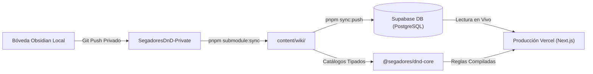

# SegadoresDnD 🎲⚔️

Sitio web privado para campaña de Dungeons & Dragons con wiki integrada desde Obsidian y gestor interactivo de hojas de personaje.

## 📖 Documentación del Proyecto

* 👉 **[PROJECT_SPEC.md](./PROJECT_SPEC.md)**: Arquitectura completa, stack tecnológico, contratos de datos y roadmap.
* 👉 **[DATABASE_SYNC_GUIDE.md](./docs/DATABASE_SYNC_GUIDE.md)**: Pipeline canónico de datos (Bóveda -> GitHub -> content/wiki/ -> Supabase -> Vercel) y comandos de sincronización.
* 👉 **[GEMINI.md](./GEMINI.md)**: Reglas obligatorias de desarrollo y licenciamiento para modelos de IA.
* 👉 **[SYSTEM_SPECS.md](./SYSTEM_SPECS.md)**: Especificaciones del sistema del usuario (Arch Linux, KDE Wayland, AUR con `yay`, etc.).
* 👉 **[CHANGELOG.md](./CHANGELOG.md)**: Registro histórico de cambios y versiones (Keep a Changelog).

## 🔄 Flujo Canónico de Datos y Sincronización



Para sincronizar datos:
```bash
# 1. Traer últimas notas del repo privado al submódulo
pnpm submodule:sync

# 2. Parsear y subir fichas y baúl comunal a Supabase
pnpm sync:push
```

## 🚀 Resumen del Stack

* **Frontend & Backend:** Next.js (App Router) + TypeScript
* **Estilos:** Tailwind CSS + shadcn/ui
* **Base de Datos & Auth:** Supabase (PostgreSQL + Google OAuth + Realtime)
* **Despliegue & Hosting:** Vercel (Hobby Tier) + Vercel CLI global
* **Dominio:** Namecheap DNS
* **Fuente de Lore:** Bóveda de Obsidian (Markdown)

## 📄 Licencia

Este proyecto está bajo la Licencia **[MIT](./LICENSE)** - Autor: [williamatr](https://github.com/williamatr).
Las reglas básicas de D&D están amparadas por la licencia Creative Commons (CC-BY-4.0) del SRD 5.1 de Wizards of the Coast.

