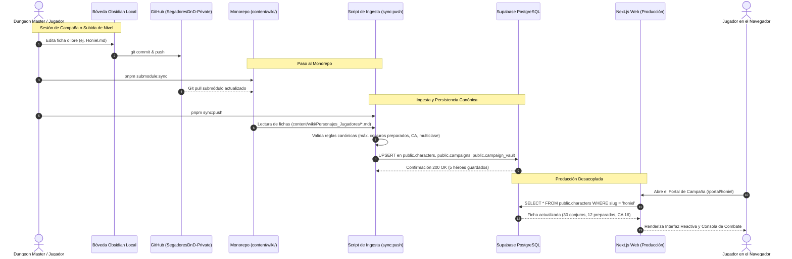

# 🔄 Guía Canónica de Sincronización de Base de Datos y Lore (SegadoresDnD)

Este documento detalla la arquitectura de datos, el flujo de sincronización y las políticas de persistencia del monorepo **SegadoresDnD** entre la Bóveda de Obsidian, el submódulo Git privado, la base de datos PostgreSQL en Supabase y la aplicación web en producción desplegada en Vercel.

---

## 1. 📐 Arquitectura General del Pipeline de Datos (3 Eslabones)

```mermaid
flowchart LR
    subgraph Boveda ["1. Bóveda Obsidian & Lore"]
        direction TB
        A["Bóveda de Obsidian del DM"] -->|"Git Push Seguro"| B["Repo Privado:\nSegadoresDnD-Private"]
    end

    subgraph Monorepo ["2. Monorepo SegadoresDnD"]
        direction TB
        B -->|"Submódulo Git\n(pnpm submodule:sync)"| C["Submódulo:\ncontent/wiki/"]
        C -->|"Scripts de Ingesta\n(scripts/sync-characters-push.mjs)"| D["Parser Canónico\nMarkdown + YAML"]
        D -->|"Actualización de Catálogos"| E["@segadores/dnd-core\n+ Fallbacks Tipados en Código"]
    end

    subgraph Backend ["3. Nube y Base de Datos"]
        direction TB
        D -->|"UPSERT REST API\n(Service Role)"| F[("Supabase PostgreSQL\n(public.characters,\ncampaigns, vault)")]
    end

    subgraph Produccion ["4. Aplicación en Producción (Vercel)"]
        direction TB
        F -->|"Fetch en Vivo\n(revalidate: 0)"| G["Next.js App Router\n(apps/segadores-web)"]
        E -->|"Reglas y Fallbacks Compilados"| G
        G -->|"Componentes Controlados"| H["Hojas de Personaje\n(@segadores/character-sheet)"]
    end

    style Boveda fill:#1c1917,stroke:#ca8a04,stroke-width:2px,color:#fef08a
    style Monorepo fill:#292524,stroke:#dc2626,stroke-width:2px,color:#fecaca
    style Backend fill:#18181b,stroke:#059669,stroke-width:2px,color:#a7f3d0
    style Produccion fill:#09090b,stroke:#2563eb,stroke-width:2px,color:#bfdbfe
```

---

## 2. 🛡️ Regla Estricta: Prohibición Absoluta de Rutas Locales Externas

> [!CAUTION] Regla Crítica para Todos los Desarrolladores y Agentes de IA
> **Está terminantemente prohibido que cualquier script, test o componente de Next.js haga referencia o lea rutas del sistema de archivos local del host** (como `/home/william/Proyectos/Obsidian/Bochica/DnD`).
> 
> **Motivo Técnico:**
> 1. En los servidores de compilación y ejecución de **Vercel**, en **GitHub Actions** y en entornos Docker, esas rutas locales del host **no existen**. Cualquier código que intente acceder a ellas provocará excepciones inmediatas de `ENOENT` y caída de la aplicación.
> 2. Toda la información viva de la campaña reside en el submódulo `content/wiki/` (para sincronización local) y en las tablas de **Supabase** (para consumo en producción).

---

## 3. 🌊 Secuencia de Sincronización y Ciclo de Vida

---

## 4. 🗄️ Esquema de Tablas en Supabase

Las tablas en `public` estructuran todos los datos sin depender del sistema de archivos:

### `public.characters`
* `id` (`text`, Primary Key): Identificador único (`char-honiel`, `char-alizar`, etc.).
* `slug` (`text`, Unique): Clave para rutas dinámicas (`honiel`, `eru`, `solaria`, `alizar`, `zuma`).
* `name` (`text`): Nombre completo del aventurero.
* `character_class` (`text`): Descripción editorial de clase (`Mago / Monje`, etc.).
* `level` (`integer`): Nivel total del personaje.
* `experience_points` (`integer`): Puntos de experiencia acumulados.
* `max_hp`, `current_hp`, `temp_hp` (`integer`): Gestión de vitalidad y absorción.
* `armor_class`, `speed`, `proficiency_bonus` (`integer`): Estadísticas de combate.
* `ability_scores` (`jsonb`): Puntuaciones de característica `{ str, dex, con, int, wis, cha }`.
* `saving_throws_prof` (`text[]`): Tiradas de salvación competentes.
* `skills` (`jsonb`): Habilidades con bonificadores y competencia (`proficient` o `expertise`).
* `multiclass` (`jsonb`): Desglose de clases y subclases con niveles individuales.
* `spell_slots` (`jsonb`): Espacios de conjuro totales y consumidos por nivel `{ "1": { total: 4, used: 0 }, ... }`.
* `known_spells` (`text[]`): Catálogo total de conjuros conocidos / en el grimorio (ej. los 30 conjuros de Honiel).
* `prepared_spells` (`text[]`): Conjuros preparados para la jornada (máx. 12 para Honiel a Nv.7 Mago + INT 20).
* `inventory` (`jsonb`): Lista de objetos con categorías (`weapon`, `armor`, `magic_item`, `gear`), cantidad, sintonización (`requires_attunement`, `attuned`), equipamiento (`equipped`) y propiedades de combate.
* `class_resources` (`jsonb`): Recursos tácticos de clase (Puntos de Ki, Recuperación Arcana, Inspiración Bárdica, etc.).
* `personality` (`jsonb`): Rasgos, ideales, vínculos y defectos.

### `public.campaigns`
* `id` (`uuid`, Primary Key): Identificador de campaña.
* `code` (`text`, Unique): Código canónico (`SEG-001`).
* `name` (`text`): Nombre (`Segadores de Orcos`).
* `status` (`text`): Estado (`active`, `archived`).

### `public.campaign_vault`
* `campaign_id` (`uuid`, Foreign Key): Enlace a la campaña.
* `items` (`jsonb`): Pertenencias compartidas de la compañía (carreta, provisiones, bardas, etc.).

### `public.campaign_characters`
* `campaign_id` (`uuid`) y `character_id` (`text`): Relación N:M que asocia qué personajes forman la compañía activa.

---

## 5. 🛠️ Comandos de Terminal para Sincronización

| Comando | Acción | Cuándo Usarlo |
|---|---|---|
| `pnpm submodule:sync` | Sincroniza el submódulo `content/wiki/` desde `SegadoresDnD-Private`. | Tras realizar cambios en la bóveda de Obsidian. |
| `pnpm sync:push` | Lee `content/wiki/` y sube los personajes a Supabase (`public.characters`). | Tras actualizar fichas, hechizos o inventario. |
| `pnpm sync:push --dry-run` | Valida el parseo y cálculo de reglas sin enviar peticiones a Supabase. | Antes de ejecutar una subida a base de datos. |
| `pnpm sync:demo` | Sincroniza las fichas canónicas hacia `lib/campaign/characters.ts`. | Para garantizar que la demo estática y los tests offline reflejen la wiki. |

---

## 6. 🚀 Resiliencia en Vercel (Producción)

1. **Submódulo Git Tolerante a Fallos:** En Vercel, el builder puede no disponer de las claves SSH del repositorio privado `SegadoresDnD-Private`. La aplicación está diseñada para que el proceso de build continúe limpiamente sin arrojar excepciones.
2. **Fuente de Verdad en Producción:** `apps/segadores-web` se alimenta en runtime de **Supabase** a través de las credenciales de entorno (`NEXT_PUBLIC_SUPABASE_URL`, `NEXT_PUBLIC_SUPABASE_ANON_KEY`), con fallback a `@segadores/dnd-core` y `content/mocks/`.
3. **Cero Dependencia de Disco Local:** La web nunca invoca `fs.readFileSync` sobre rutas absolutas del host del desarrollador.
