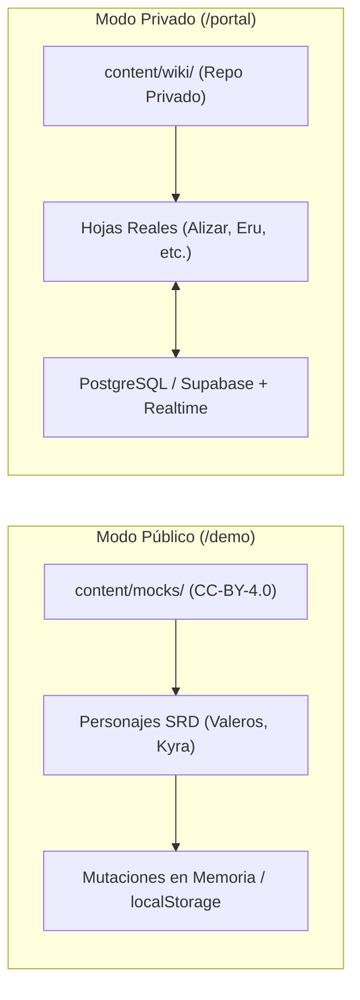

# 01 - Visión General del Sistema (System Overview)

## 1. Propósito y Misión

**SegadoresDnD** es una plataforma web modular, moderna y en español bajo el principio de **software libre**, concebida para la gestión de campañas de Dungeons & Dragons (D&D).

Nació como una solución a medida para la campaña personal de **William Tovar** (*Segadores de Orcos*), y ha evolucionado hacia una arquitectura de código abierto desacoplada que cualquier director de juego o jugador puede adoptar o adaptar.

---

## 2. El Problema que Resuelve

1. **La brecha entre el DM y los Jugadores:**
   * El DM gestiona su mundo, PNJs, reglas y sesiones en su bóveda privada de **Obsidian**.
   * Los jugadores no deben tener acceso al sistema de archivos local ni a las notas secretas del DM, pero necesitan una interfaz web ágil para interactuar con su hoja de personaje durante las sesiones.
2. **Propiedad Intelectual y Licenciamiento Dual:**
   * El código de la aplicación es **100% libre y abierto (Licencia MIT)**.
   * El contenido oficial de D&D y las reglas públicas están amparados bajo la licencia **Creative Commons (CC-BY-4.0)** mediante el System Reference Document (SRD 5.1 / 5.2.1).
   * El material con derechos comerciales exclusivos o notas confidenciales de campaña vive en un repositorio privado aislado (`content/wiki/`), sin contaminar el código público.

---

## 3. La Dualidad de Modos: Demo Pública vs Campaña Privada

* **Modo Público / Demo (`/demo`):** Diseñado para reclutadores, desarrolladores o visitantes. Permite interactuar con la hoja y el catálogo de hechizos sin login, usando datos de prueba.
* **Modo Privado (`/portal`):** Diseñado para la mesa de juego real. Requiere Google OAuth, valida el correo contra `ALLOWED_EMAILS` y conecta a la base de datos PostgreSQL en vivo.
