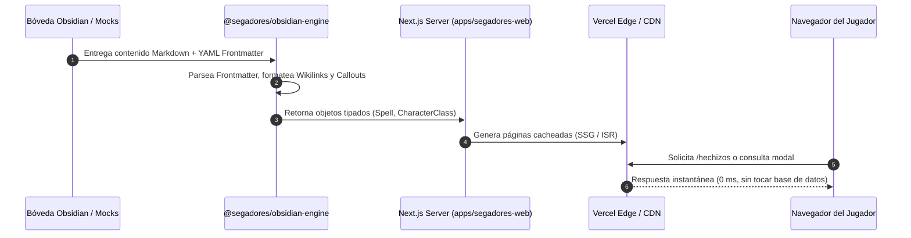
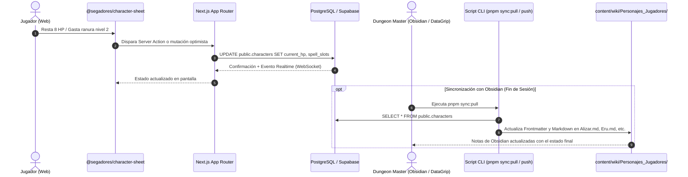

# 02 - Flujos de Datos (Data Flow Architecture)

El sistema opera bajo una distinción arquitectónica estricta entre **datos referenciales estáticos** y **datos de estado interactivo**.

---

## 1. Flujo Unidireccional (Datos Referenciales: Hechizos, Clases, Equipo)

Las reglas, conjuros, clases y descripciones de equipo son datos estáticos que no mutan durante una sesión de combate. Se leen desde Markdown en tiempo de compilación o Server-Side Rendering (SSR).



---

## 2. Flujo Bidireccional (Hojas de Personaje: Estado en Vivo)

Los puntos de golpe (HP), ranuras de conjuro gastadas, inventario y notas de sesión cambian segundo a segundo en combate. Requieren persistencia inmediata en PostgreSQL y sincronización con las notas del DM.



---

## 4. Guía Maestra de Sincronización

Para consultar los diagramas completos del pipeline de 3 eslabones (`Bóveda -> GitHub -> content/wiki/ -> Supabase -> Vercel`), la estructura exacta de tablas y la prohibición estricta de rutas locales externas, consulta **[Guía Canónica de Sincronización de Base de Datos y Lore](../DATABASE_SYNC_GUIDE.md)**.


```text
┌──────────────────────┬──────────────────────┬─────────────────────────────────────┐
│ Tipo de Información  │ Almacenamiento       │ Justificación Técnica               │
├──────────────────────┼──────────────────────┼─────────────────────────────────────┤
│ Vitalidad (HP/Dados) │ PostgreSQL (DB)      │ Mutaciones frecuentes en combate.   │
│ Ranuras de Conjuro   │ PostgreSQL (DB)      │ Estado volátil por descanso.        │
│ Inventario / Oro     │ PostgreSQL (JSONB)   │ Mutaciones en sesión.               │
│ Catálogo de Hechizos │ Markdown / JSON      │ Estático; búsqueda ultra rápida.    │
│ Reglas de Clases     │ Markdown / JSON      │ Canónico SRD 5.1/5.2.               │
│ Notas Privadas DM    │ Obsidian (content/)  │ Jamás expuestas a los jugadores.    │
└──────────────────────┴──────────────────────┴─────────────────────────────────────┘
```
