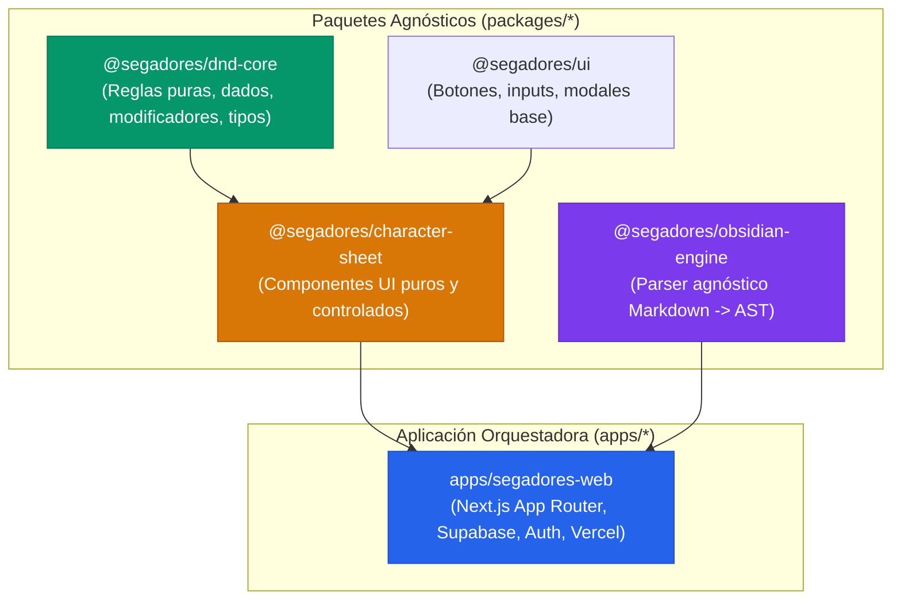

# 03 - Estructura del Monorepo e Inversión de Dependencias

## 1. Principio de Inversión de Dependencias (Dependency Inversion)

Para evitar el acoplamiento y permitir que los componentes de la interfaz de usuario se puedan reutilizar o publicar en npm de forma independiente, seguimos una jerarquía estricta:



---

## 2. Reglas Estrictas de Dependencias (Boundaries)

1. **`packages/*` NUNCA importan nada de `apps/*`:**
   * La flecha de dependencia apunta siempre hacia abajo.
2. **`packages/character-sheet` y `packages/obsidian-engine` NUNCA importan Supabase:**
   * Reciben datos mediante `props` tipadas de TypeScript.
   * Notifican acciones mediante callbacks (`onSave`, `onRoll`, `onDamage`).
3. **`packages/dnd-core` es TypeScript Puro (Zero Dependencies):**
   * No tiene dependencias de React, ni de librerías de UI, ni de motores de base de datos.
   * Contiene únicamente funciones puras y tipos (`calculateAbilityModifier`, `calculateProficiencyBonus`).

---

## 3. Estructura de Directorios

```text
SegadoresDnD/
├── apps/
│   └── segadores-web/           # Orquestador Next.js App Router
├── packages/
│   ├── dnd-core/                # Fórmulas, dados, reglas SRD y tipos
│   ├── character-sheet/         # Componentes UI desacoplados de la hoja
│   ├── obsidian-engine/         # Motor parser de Markdown, wikilinks y callouts
│   └── ui/                      # Componentes base compartidos
├── content/
│   ├── wiki/                    # Submódulo Git: notas privadas de campaña
│   └── mocks/                   # Fixtures públicos SRD (CC-BY-4.0)
├── scripts/                     # Scripts CLI de sincronización (DB <-> Obsidian)
├── docs/architecture/           # Documentación y diagramas arquitectónicos
├── .agents/                     # Especificaciones de roles para subagentes
├── turbo.json                   # Pipeline de compilación y caché
└── pnpm-workspace.yaml          # Definición de workspaces
```
