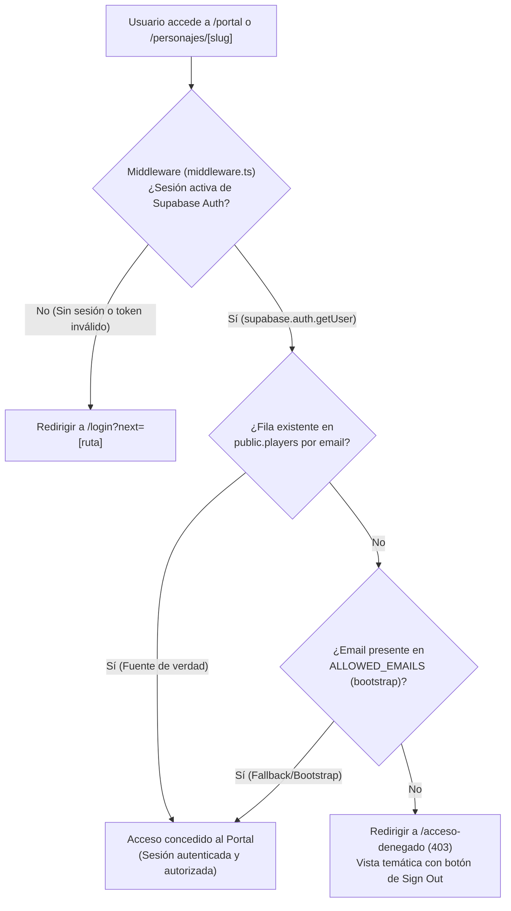
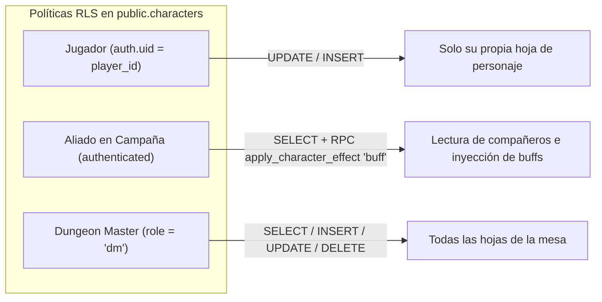

# 04 - Seguridad, Roles y Anti-Metajuego (Security & Permissions)

La seguridad del sistema opera en tres capas: **Autenticación en el Edge (Next.js Middleware)**, **Reglas de Acceso a Base de Datos (PostgreSQL RLS)** y **Filtrado de Contenido en el Motor de Markdown (Anti-Metajuego)**.

---

## 1. Autenticación y Lista Blanca (Allowlist en Dos Niveles)

* **Proveedor de Autenticación:** Google OAuth a través del cliente `@supabase/ssr` con validación criptográfica en el servidor (`supabase.auth.getUser()`).
* **Control de Acceso en Dos Niveles:**
  1. **Fuente de verdad primaria:** Tabla `public.players` (registro pre-cargado por el DM con rol `'player'` o `'dm'`).
  2. **Allowlist de emergencia / bootstrap:** Variable de entorno `ALLOWED_EMAILS` (cadena separada por comas).
* **Intercambio y Vinculación (`/auth/callback`):**
  * Intercambia el código OAuth de Google (`code`) por tokens de sesión y gestiona cookies en el navegador.
  * Emplea un cliente administrativo con `SUPABASE_SERVICE_ROLE_KEY` (aislado en el servidor en `lib/supabase/admin.ts`) para asociar `auth_user_id = auth.uid()` en `public.players`.
  * Si el email figura en `ALLOWED_EMAILS` pero no tiene registro previo en `public.players`, crea automáticamente el perfil asignando de forma estricta `role = 'player'` (bloqueo total de auto-asignación del rol `'dm'`).
  * Validación contra ataques de redirección abierta (*Open Redirect*): el parámetro `next` solo acepta rutas relativas seguras (`/` y no `//`).
* **Cierre de Sesión Seguro (`/auth/signout`):**
  * Endpoint POST que revoca la sesión activa en Supabase Auth y redirige al inicio (`/`) con código HTTP 303.

---

## 2. Row Level Security (RLS) en PostgreSQL

1. **Lectura de Mesa y Edición de Propietario:**
   * Los miembros autenticados de la mesa tienen lectura (`SELECT`) sobre las hojas activas para consultar el estado del grupo y aplicar efectos de tipo `'buff'` mediante la función segura `public.apply_character_effect()`.
   * La edición directa (`UPDATE`) y el retiro de efectos (`public.remove_character_effect()`) están estrictamente restringidos al propietario de la ficha o al DM.
   * En `public.players`, la política `WITH CHECK` impide que un jugador modifique su propio `role` o `email` (bloqueo de escalada de privilegios).
2. **Acceso del DM:**
   * Los usuarios con `role: 'dm'` en la tabla `players` (validado mediante `public.is_dm()` con `SECURITY DEFINER SET search_path = public`) tienen permisos de lectura y escritura sobre todas las fichas, campañas y el baúl común.

---

## 3. Filtrado Anti-Metajuego (Player vs DM)

En D&D, el *metajuego* ocurre cuando los jugadores acceden a información confidencial del DM (estadísticas ocultas de monstruos, trampas, intenciones de PNJs).

El motor `@segadores/obsidian-engine` implementa un filtro estricto al renderizar notas:

* **Callouts Secretos:** Bloques `> [!dm]` dentro de cualquier nota son **purgados completamente del árbol AST** antes de enviarse al cliente si el rol es `'player'`.
* **Carpetas Restringidas:** Rutas como `Campañas predefinidas/` o `Bestiario/` devuelven `404 Not Found` automático si el usuario no es DM.
* **Marcas de Visibilidad:** Frontmatter `visibility: dm` o tags `#dm-only` excluyen la nota del índice público y de los resultados de búsqueda.
