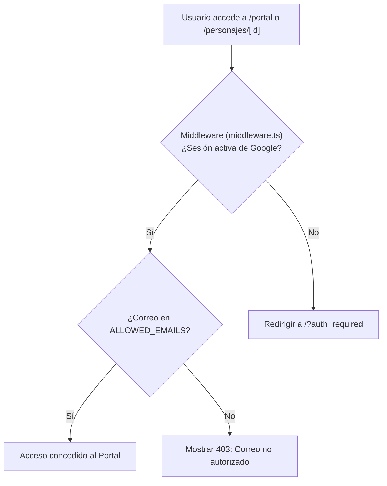
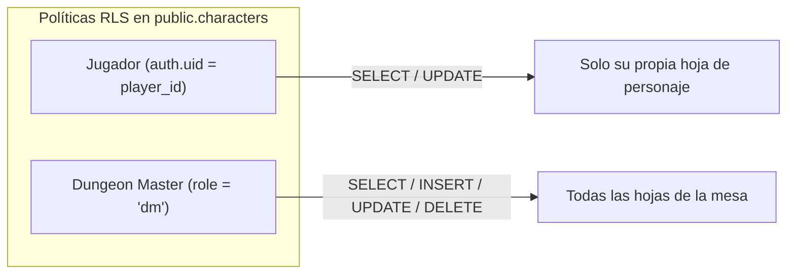

# 04 - Seguridad, Roles y Anti-Metajuego (Security & Permissions)

La seguridad del sistema opera en tres capas: **Autenticación en el Edge (Next.js Middleware)**, **Reglas de Acceso a Base de Datos (PostgreSQL RLS)** y **Filtrado de Contenido en el Motor de Markdown (Anti-Metajuego)**.

---

## 1. Autenticación y Lista Blanca (Allowlist)

* **Proveedor de Auth:** Google OAuth a través de Supabase Auth.
* **Control de Lista Blanca:** Variable de entorno `ALLOWED_EMAILS` (cadena separada por comas) validada en el Edge antes de procesar cualquier Server Component.

---

## 2. Row Level Security (RLS) en PostgreSQL

1. **Lectura y Edición de Jugadores:**
   * Cada jugador solo puede ver y editar la fila de `public.characters` cuyo `player_id` coincida con su identidad autenticada.
2. **Acceso del DM:**
   * Los usuarios con `role: 'dm'` en la tabla `players` tienen permisos de lectura y escritura sobre todas las fichas de combate.

---

## 3. Filtrado Anti-Metajuego (Player vs DM)

En D&D, el *metajuego* ocurre cuando los jugadores acceden a información confidencial del DM (estadísticas ocultas de monstruos, trampas, intenciones de PNJs).

El motor `@segadores/obsidian-engine` implementa un filtro estricto al renderizar notas:

* **Callouts Secretos:** Bloques `> [!dm]` dentro de cualquier nota son **purgados completamente del árbol AST** antes de enviarse al cliente si el rol es `'player'`.
* **Carpetas Restringidas:** Rutas como `Campañas predefinidas/` o `Bestiario/` devuelven `404 Not Found` automático si el usuario no es DM.
* **Marcas de Visibilidad:** Frontmatter `visibility: dm` o tags `#dm-only` excluyen la nota del índice público y de los resultados de búsqueda.
