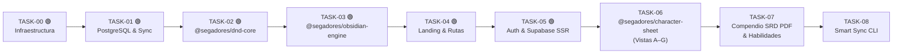

# Tablero de Tareas y Backlog - SegadoresDnD

> **Índice central de épicas y subtareas para el Agente Orquestador y desarrolladores.**
> Este documento rige el ciclo de vida de cualquier funcionalidad. Las tareas están ordenadas en **secuencia estricta de dependencias (`TASK-00` $\rightarrow$ `TASK-07`)**, donde cada épica desbloquea a la siguiente sin saltos ni bloqueos cruzados.

---

## 📜 Reglas de Gestión de Tareas (Protocolo de Backlog)

Cuando el usuario solicita implementar una funcionalidad o idea nueva, todos los agentes deben seguir este protocolo:

1. **Búsqueda y Mapeo Previo:**
   * El Orquestador revisa este tablero antes de escribir una sola línea de código.
2. **Si encaja en una Épica existente:**
   * **Incompleta:** Toma la siguiente subtarea pendiente `[ ]` sin rehacer lo que ya esté marcado con `[x]`.
   * **Completada:** Si se trata de una mejora o extensión, **añade una nueva subtarea (`SUBTASK-XX.N`)** a esa épica con su respectivo checklist, conservando intacto el historial anterior.
3. **Si es una funcionalidad nueva:**
   * Crea un nuevo archivo `docs/tasks/task-XX-[nombre].md` siguiendo la plantilla estándar de épica.
   * Añade la nueva épica a la tabla de este archivo.
4. **Registro Histórico Obligatorio (Log):**
   * Al finalizar cada subtarea, se marca con `[x]` y se añade una fila a la tabla de **Registro de Ejecución y Cambios** de esa tarea con fecha, agente responsable y resumen de lo realizado.

---

## 📋 Tablero Secuencial de Épicas (Sprint 1: MVP Portal del Jugador)

| ID | Épica / Módulo | Estado | Agentes Asignados | Archivo de Especificación |
| :--- | :--- | :---: | :--- | :--- |
| **TASK-00** | **Infraestructura Base y Next.js Shell** | 🟢 Completada | `frontend-engineer`, `qa-integration-tester` | [task-00-base-infrastructure.md](./task-00-base-infrastructure.md) |
| **TASK-01** | **Base de Datos PostgreSQL, RLS y Sync Base** | 🟢 Completada | `backend-engineer`, `solution-architect-critic` | [task-01-database-and-sync.md](./task-01-database-and-sync.md) |
| **TASK-02** | **Core de Reglas D&D 5.5e y Evaluador de Estados (`@segadores/dnd-core`)** | 🟢 Completada | `backend-engineer`, `qa-integration-tester` | [task-02-dnd-core-rules-engine.md](./task-02-dnd-core-rules-engine.md) |
| **TASK-03** | **Motor Markdown, Callouts y Anti-Metajuego (`@segadores/obsidian-engine`)** | 🟢 Completada | `backend-engineer`, `frontend-engineer` | [task-03-obsidian-engine.md](./task-03-obsidian-engine.md) |
| **TASK-04** | **Landing Page, Compendio `/hechizos` y Cascarón de Rutas (`/demo`, `/portal`)** | 🟢 Completada | `frontend-engineer`, `theme-design-reviewer` | [task-04-landing-and-routes.md](./task-04-landing-and-routes.md) |
| **TASK-05** | **Autenticación Google OAuth, Allowlist y Clientes Supabase SSR** | 🟢 Completada | `backend-engineer`, `solution-architect-critic` | [task-05-auth-and-access-control.md](./task-05-auth-and-access-control.md) |
| **TASK-06** | **Suite de Hojas de Personaje: Las 7 Vistas Interactivas (A–G) (`@segadores/character-sheet`)** | 🟡 Pendiente | `frontend-engineer`, `theme-design-reviewer` | [task-06-character-sheet-ui.md](./task-06-character-sheet-ui.md) |
| **TASK-07** | **Ingesta del Compendio Público SRD 5.2.1 (PDF), Habilidades y Segregación** | 🟡 Pendiente | `backend-engineer`, `frontend-engineer` | [task-07-public-srd-compendium.md](./task-07-public-srd-compendium.md) |
| **TASK-08** | **Motor CLI de Sincronización Inteligente (`sync:diff` y `sync:smart`)** | 🟡 Pendiente | `backend-engineer`, `solution-architect-critic` | [task-08-smart-sync-engine.md](./task-08-smart-sync-engine.md) |

---

## 🔄 Mapa de Dependencias Secuenciales

